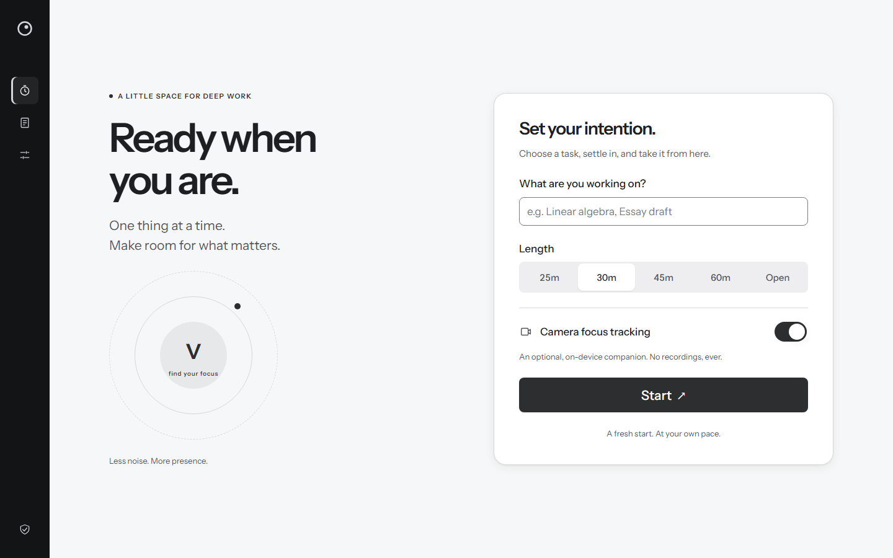
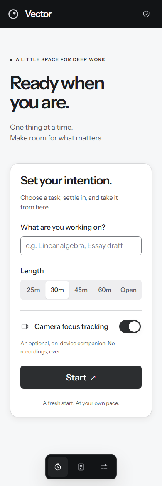
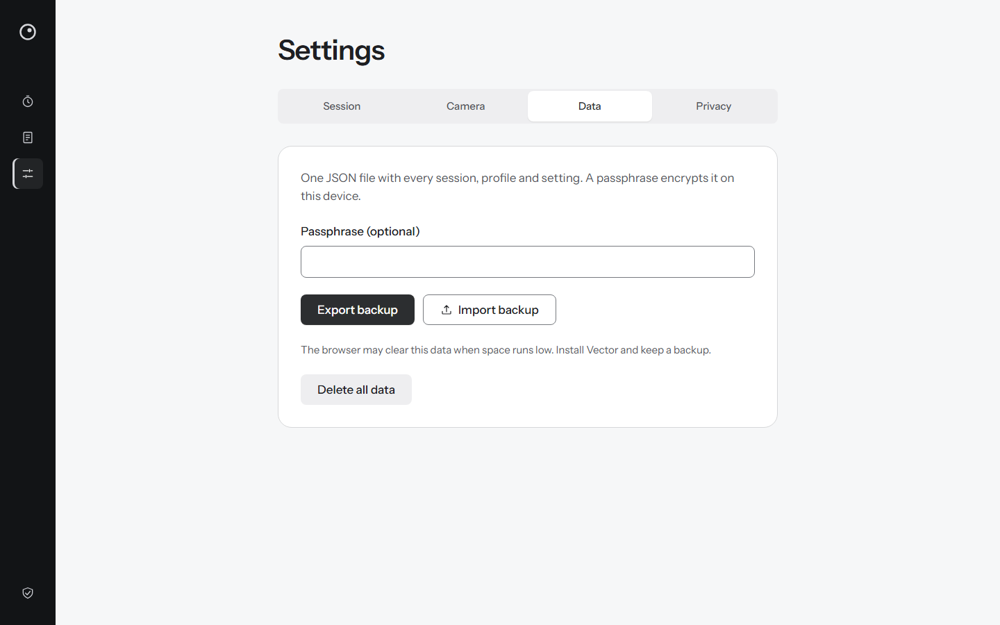
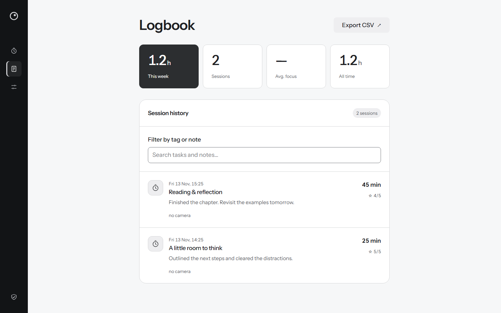

# Vector

Uno spazio essenziale per studiare e lavorare con attenzione. Una PWA open source, con timer, logbook e supporto opzionale della webcam elaborato sul dispositivo.

Vector nasce da esigenze personali: organizzare momenti di studio concentrato, accorgersi quando serve una pausa e conservare una traccia utile del lavoro svolto. Il punto di partenza è stato lo studio della teoria per il PPL(A); da lì il progetto si è concentrato su un bisogno più generale: aprire l’app, scegliere una cosa e dedicarle attenzione.

## Anteprima



| Focus su telefono | Dati e backup |
| --- | --- |
|  |  |



Gli screenshot sono acquisiti dalla build locale in un browser isolato. Il Logbook usa esclusivamente dati dimostrativi; nessun dato personale viene incluso. Per rigenerarli: `pnpm docs:screenshots` (richiede Chromium di Playwright).

## Cosa fa oggi

- **Focus**: attività libera, sessioni da 25, 30, 45 o 60 minuti, oppure modalità Open. Pausa, ripresa e recupero della sessione dopo un reload. Il timer può rimanere nascosto per ridurre le distrazioni.
- **Webcam opzionale**: calibrazione della postura, rilevamento locale di assenza, distrazione e affaticamento, suggerimenti di pausa con una spiegazione. La sessione funziona anche senza webcam.
- **Chiusura della sessione**: valutazione della chiarezza da 1 a 5 e nota facoltativa.
- **Logbook**: statistiche settimanali e complessive, cronologia, filtro su attività e note, esportazione CSV. Il focus medio appare solo quando esistono misurazioni della webcam.
- **Impostazioni**: durata, timer, suono, sensibilità e profili di postura. Backup JSON, cifratura facoltativa con passphrase, importazione con merge e cancellazione con doppia conferma.
- **PWA**: installabile e utilizzabile offline dopo il primo caricamento. La webcam offline richiede che modello e WASM siano già stati scaricati e conservati nella cache.

L’interfaccia è in inglese. La versione attuale segue il [piano v3 Lite](docs/PIANO-V3-LITE.md); il precedente planner e la sincronizzazione remota non fanno parte di questa versione.

## Design system

**Vector Studio** usa superfici chiare, accento nero fumo e Instrument Sans variabile servito dall’app, con cifre tabulari. I token semantici di colore, tipografia, spaziatura, forma e movimento vivono in [`tokens.css`](src/styles/tokens.css); i componenti condivisi sono in [`src/components`](src/components).

Su desktop il contenitore occupa un singolo viewport, con una barra di navigazione da 80 px composta da icone e tooltip accessibili. Le pagine lunghe scorrono nell’area principale. Su mobile la navigazione diventa un dock inferiore. Ogni pagina ha una sola headline; il caricamento usa skeleton con supporto a reduced motion. L’importazione mantiene un input file nativo accessibile dentro un controllo coerente con il design.

La pagina interna `/vector/style` raccoglie token e stati dei componenti. Le motivazioni e i compromessi sono nelle [decisioni architetturali](docs/decisions/README.md).

## Privacy e dati

Sessioni, impostazioni e profili vivono in IndexedDB; la sessione in corso usa localStorage per riprendere rapidamente. Non servono account o server applicativi. Font, modelli e WASM vengono serviti dalla stessa origine. I frame della webcam sono elaborati in memoria da MediaPipe in un Web Worker: non sono registrati né inviati; vengono salvati solo aggregati numerici per sessione.

La build applica una Content Security Policy che limita le connessioni della pagina alla stessa origine. Il worker applica inoltre una policy alle fetch del SDK: le richieste esterne, inclusa la telemetria di MediaPipe, vengono rifiutate prima della rete; i redirect delle fetch locali sono disabilitati. I backup sono cifrati sul dispositivo quando viene specificata una passphrase; la passphrase non viene salvata. La persistenza dello storage dipende dal browser: esportare un backup resta necessario per proteggersi dalla cancellazione dei dati locali. Il rilevamento della webcam è un’indicazione pratica, non una misura clinica della concentrazione o della stanchezza.

## Sviluppo

Node **26** (vedi [`.nvmrc`](.nvmrc)) e la versione di pnpm fissata in [`package.json`](package.json).

```sh
pnpm install --frozen-lockfile
pnpm dev                     # http://localhost:4321/vector/
pnpm check                   # typecheck, lint, unit test, coverage, build, budget
pnpm exec playwright install chromium
pnpm e2e                     # flussi browser e accessibilità, desktop e telefono
pnpm docs:screenshots        # build e screenshot riproducibili
```

Stack: Astro statico, Svelte 5, TypeScript, Dexie, Zod e MediaPipe. Il rinnovo visivo riusa queste dipendenze: token CSS e componenti nativi bastano per mantenere il caricamento leggero, senza introdurre un framework UI aggiuntivo.

## Qualità e strict gates

I controlli sono eseguibili localmente e in CI: un gate fallito termina il comando con errore.

| Gate | Cosa blocca |
| --- | --- |
| TypeScript, Astro e Svelte | Configurazione `strictest`; errori e warning fanno fallire i controlli. |
| Biome | Formattazione e lint, inclusi warning, import inutilizzati e regole del repository. |
| Vitest + V8 | Test della logica e dei dati. Per `core/focus` e `core/session`: **100%** di righe, branch, funzioni e statement. La soglia non è globale a tutta l’app. |
| Contrasto dei token | Coppie testo/sfondo almeno **4.5:1**, bordi dei controlli almeno **3:1**, colori nel gamut sRGB. |
| Build di produzione | Preparazione dei modelli, generazione statica e service worker. |
| Budget JavaScript | Pagina Focus sotto **50 kB gzip** di JS iniziale secondo lo script di misurazione; import dinamici esclusi dal caricamento iniziale. |
| Playwright + axe-core | Flusso sessione, ripristino, webcam simulata, offline, backup, navigazione, assenza di overflow a 360 px, reduced motion e accessibilità automatizzata. |

La [CI](.github/workflows/ci.yml) esegue `pnpm check` e `pnpm e2e` in due job. Il [deploy Pages](.github/workflows/pages.yml) automatico parte dopo CI riuscita su `main` e usa lo stesso commit; anche il deploy manuale esegue entrambi i gate prima di pubblicare. Le dipendenze sono installate con lockfile congelato e le GitHub Actions sono fissate a commit. Rendere questi check obbligatori per il merge richiede anche la branch protection nelle impostazioni GitHub.

I gate automatici riducono le regressioni; non sostituiscono la revisione del codice, la verifica visiva e le prove con una webcam reale. Le scelte su questi limiti sono documentate in [ADR 0013](docs/decisions/0013-quality-gates.md).

## Licenza

[MIT](LICENSE).
